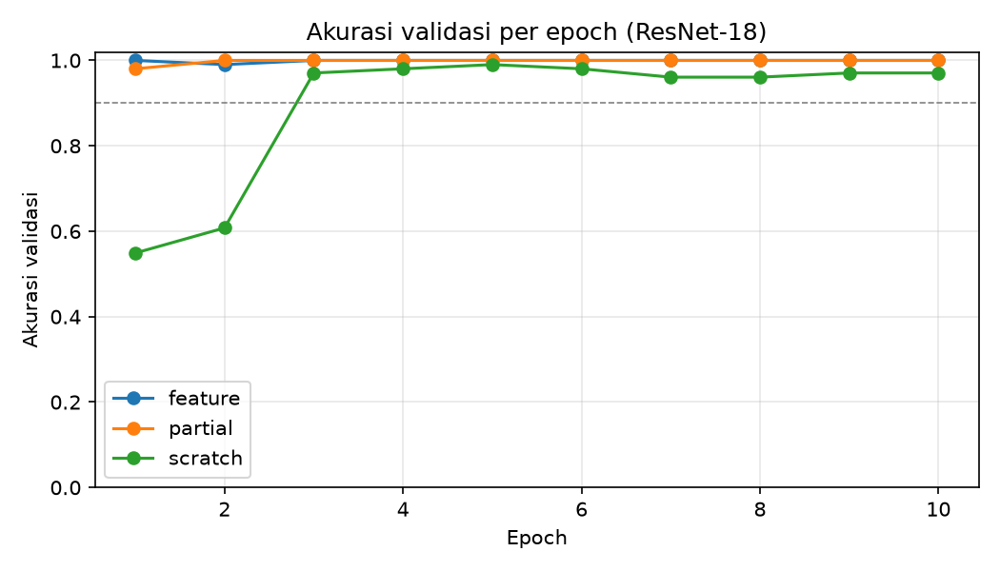

# RET503 P2 – Transfer Learning dan Fine-Tuning: Klasifikasi Pena vs Kotak Kabel

**Mata kuliah:** RET503 Computer Vision and Deep Learning – Pertemuan 3
**Program Studi:** Teknologi Rekayasa Robotika, Politeknik Negeri Batam
**Nama: Nabila Maharani Syawitri**
**NIM: 4222411015**

## 1. Ringkasan

Praktikum ini membandingkan tiga pendekatan pelatihan ResNet-18 (feature extraction, fine-tuning parsial, dan pelatihan dari nol) untuk mengklasifikasikan dua objek: **pena** dan **kotak kabel**. Citra diambil dari kamera **Intel RealSense D455 (stream RGB)**, dikoreksi distorsinya (undistort) memakai hasil kalibrasi, lalu dipakai untuk melatih dan menguji model. Latensi ResNet-18 dan MobileNetV3-Small juga diukur terhadap anggaran 15 FPS (±67 ms per frame).

**Temuan utama**
- Transfer learning (feature dan partial) mencapai akurasi validasi ≥ 90% sejak **epoch 1**, sedangkan scratch baru di **epoch 3**.
- Akurasi validasi terbaik: feature 100%, partial 100%, scratch 99,02%.
- Validasi memakai kondisi cahaya (`redup`) yang tidak ada di data latih (`terang`), sehingga tidak ada kebocoran data (data leakage).
- ResNet-18 dan MobileNetV3-Small sama-sama memenuhi anggaran inferensi 35 ms pada CPU laptop.

## 2. Struktur repositori

```
.
├── calibrate.py        # kalibrasi kamera (chessboard) -> calib.npz
├── find_camera.py      # mencari index kamera yang benar
├── capture.py          # langkah 1: ambil citra (undistort otomatis)
├── split.py            # langkah 2: bagi train/val per sesi / kondisi
├── train.py            # langkah 3: latih feature | partial | scratch
├── latency.py          # langkah 4: ukur latensi model
├── predict.py          # uji model: kamera langsung / confusion matrix
├── requirements.txt
├── calib.npz           # parameter kalibrasi kamera
├── calib_images/       # foto papan catur untuk kalibrasi
├── dataset_raw/        # dataset + metadata.csv + split.csv
├── results/            # tabel hasil, log, grafik, latensi
└── test_shots/         # screenshot uji kamera langsung
```

## 3. Cara menjalankan (Windows PowerShell)

```powershell
python -m venv venv
.\venv\Scripts\Activate.ps1
pip install -r requirements.txt

python calibrate.py --cam 2 --square 25            # atau: --from-folder calib_images --square 25
python capture.py pena terang --cam 2
python capture.py pena redup --cam 2
python capture.py kotak_kabel terang --cam 2
python capture.py kotak_kabel redup --cam 2
python split.py
python train.py
python latency.py
python predict.py --eval
python predict.py --cam 2
```

> Pada perangkat keras kami, kamera RGB RealSense D455 terbaca di **index 2** (index 0 dan 1 adalah stream depth/IR). Gunakan `find_camera.py` jika index berbeda.

## 4. Perangkat keras dan kalibrasi kamera

| Item | Nilai |
|---|---|
| Kamera | Intel RealSense D455 (stream RGB) |
| Resolusi | 1280 × 720 |
| Papan kalibrasi | Chessboard, 13 × 9 sudut dalam, kotak [ISI] mm |
| Jumlah foto kalibrasi | 58 (semua terpakai) |
| Reprojection error | **0,2275 px** (RMS 0,3603) |
| fx, fy | 651,4 ; 653,1 |
| cx, cy | 634,4 ; 356,2 |
| Koefisien distorsi | [-0,0540, 0,0806, -0,0009, 0,0004, -0,0260] |

Parameter disimpan di `calib.npz` dan dipakai otomatis oleh `capture.py` dan `predict.py` (selama resolusi sama dengan saat kalibrasi).

## 5. Dataset

Citra diambil di laboratorium dengan variasi jarak, posisi di citra, orientasi, dan latar. Metadata ada di `dataset_raw/metadata.csv` (kolom: `nama_file, kelas, tanggal, kondisi_cahaya, sesi`).

| Kelas | Terang | Redup | Total |
|---|---|---|---|
| kotak_kabel | 60 | 56 | 116 |
| pena | 58 | 46 | 104 |
| **Total** | 118 | 102 | **220** |

Seluruh kelas melewati target ≥ 50 citra per kelas.

### Pembagian data (mencegah data leakage)

Data dibagi **berdasarkan sesi/kondisi pengambilan**, bukan acak per frame, karena frame beruntun dari posisi hampir sama akan membuat akurasi validasi terlihat terlalu bagus. Hasil pembagian:

| Split | Kondisi | kotak_kabel | pena | Total |
|---|---|---|---|---|
| train | terang | 60 | 58 | 118 |
| val | redup | 56 | 46 | 102 |

Model tidak pernah melihat citra `redup` saat pelatihan, sehingga validasi mengukur kemampuan generalisasi terhadap perubahan cahaya.

## 6. Konfigurasi eksperimen

| Mode | Bobot awal | Yang dilatih | Learning rate |
|---|---|---|---|
| feature | ImageNet | fc saja | 1e-3 |
| partial | ImageNet | layer4 + fc | 1e-4 / 1e-3 |
| scratch | acak | semua | 1e-3 |

- Model: ResNet-18 (torchvision), optimizer Adam, 10 epoch, batch 16, CosineAnnealingLR
- Augmentasi train: RandomResizedCrop(224), HorizontalFlip, ColorJitter
- Preprocessing: RGB, 224×224, normalisasi ImageNet (mean 0,485/0,456/0,406; std 0,229/0,224/0,225)
- Lapisan beku dijaga tetap `eval()` agar statistik BatchNorm ImageNet tidak berubah
- Perangkat latih: CPU

## 7. Hasil

| Mode | Akurasi val terbaik | Epoch terbaik | Waktu latih (dtk) | Epoch akurasi ≥ 90% |
|---|---|---|---|---|
| feature | 100% | 1 | 70,8 | 1 |
| partial | 100% | 2 | 78,5 | 1 |
| scratch | 99,02% | 5 | 102,1 | 3 |



### Evaluasi akhir (`python predict.py --eval`, model feature)

Akurasi val: **100%** (102/102)

| Asli \ Prediksi | kotak_kabel | pena |
|---|---|---|
| kotak_kabel | 56 | 0 |
| pena | 0 | 46 |

### Latensi (CPU laptop, input 224×224, 100 kali pengukuran)

| Model | Parameter (juta) | Preprocess (ms) | Inferensi (ms) | Inferensi p95 (ms) | Total (ms) | FPS |
|---|---|---|---|---|---|---|
| ResNet-18 | 11,18 | 0,93 | 18,51 | 20,01 | 19,44 | 51,5 |
| MobileNetV3-Small | 1,52 | 0,88 | 5,75 | 6,66 | 6,63 | 150,9 |

Anggaran per frame pada 15 FPS adalah ±67 ms (inferensi dialokasikan 35 ms). Kedua model memenuhi anggaran. Angka ini diukur di laptop, **bukan** di komputer robot. [ISI jika diukur di perangkat robot: nama perangkat dan hasilnya]

> Catatan: jumlah parameter ResNet-18 (11,18 juta) lebih kecil dari angka referensi 11,7 juta karena head hanya 2 kelas.

### Uji kamera langsung

[ISI/SISIPKAN screenshot dari `test_shots/` dan ringkas hasilnya: posisi, jarak, cahaya, dan kegagalan yang ditemukan.]

## 8. Analisis

1. **Kecepatan konvergensi.** Mode feature dan partial mencapai akurasi validasi ≥ 90% pada epoch 1, sedangkan scratch pada epoch 3. Bobot ImageNet sudah menyediakan fitur umum (tepi, tekstur, bentuk) sehingga hanya head atau blok akhir yang perlu menyesuaikan.
2. **Waktu pelatihan.** Scratch membutuhkan 102,1 dtk, sekitar 44% lebih lama daripada feature (70,8 dtk), karena seluruh lapisan dilatih dan gradien dihitung untuk semua parameter.
3. **Akurasi akhir.** Selisih akurasi kecil (100% vs 99,02%) karena tugasnya relatif mudah: dua kelas dengan bentuk sangat berbeda dan perbedaan val hanya pada cahaya. Keunggulan transfer learning terlihat pada kecepatan dan stabilitas, bukan pada selisih akurasi akhir.
4. **Feature vs partial.** Tidak ada perbedaan akurasi. Dengan domain yang mirip dan data sedikit, feature extraction sudah cukup, sesuai matriks keputusan strategi (data sedikit + domain mirip). Partial memakan waktu lebih lama (78,5 vs 70,8 dtk) tanpa keuntungan pada tugas ini.
5. **Data leakage.** Pembagian per kondisi cahaya memastikan val tidak berisi frame kembar dari train, sehingga akurasi tinggi mencerminkan generalisasi terhadap cahaya, bukan hafalan.
6. **Pemilihan model untuk robot.** ResNet-18 (18,5 ms) dan MobileNetV3-Small (5,75 ms) sama-sama di bawah 35 ms pada CPU laptop. MobileNetV3-Small sekitar 3,2× lebih cepat dengan parameter 7,4× lebih sedikit sehingga lebih aman jika komputer robot lebih lemah dari laptop. Model yang dilatih dan dievaluasi pada praktikum ini adalah ResNet-18; latensi MobileNetV3-Small diukur untuk perbandingan. [ISI model pilihan untuk robot dan alasannya, sesuai perangkat komputasi robot]

## 9. Keterbatasan

- Validasi hanya menguji perubahan **cahaya**; latar, jarak, dan sudut kamera relatif mirip antara train dan val.
- Dataset kecil (220 citra, dua kelas) dan tugasnya mudah, sehingga akurasi mendekati 100% dan perbedaan antar mode kecil.
- Model hanya mengenal dua kelas, sehingga untuk objek lain (tangan, meja kosong) model tetap memilih salah satu kelas. Solusi: tambah kelas "latar" atau gunakan deteksi objek (YOLO, minggu 6).
- Latensi diukur di CPU laptop, bukan di komputer robot.

## 10. Referensi

- Materi RET503 Pertemuan 3 – Transfer Learning dan Fine-Tuning Model Visi, Politeknik Negeri Batam
- Yosinski dkk. (2014), *How transferable are features in deep neural networks?*
- Zeiler & Fergus (2014), *Visualizing and Understanding Convolutional Networks*
- Howard & Gugger (2020), *fastai*
- Dokumentasi torchvision (ResNet-18, MobileNetV3)
